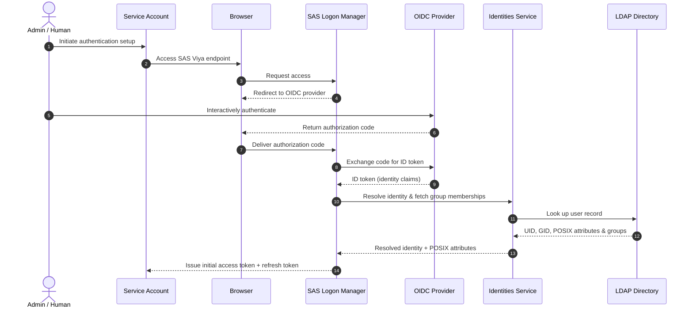
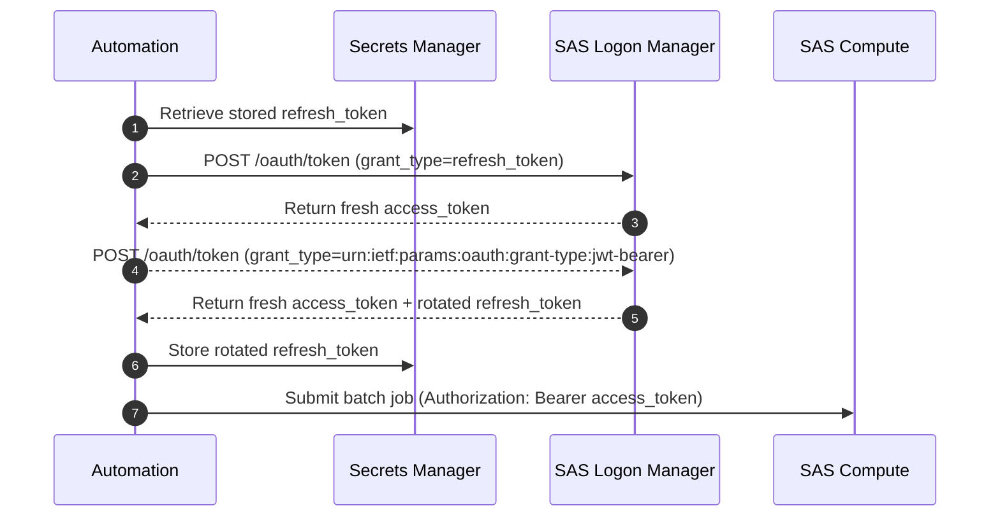

# SAS Viya Service Account Authentication Flows

Two distinct sequences make up the full lifecycle for a service account authenticating via OIDC: a **Bootstrap**, and a **Steady State** loop.

This architecture implements an industry-standard enterprise security pattern for **User Delegation & Passwordless Execution** built upon formal IETF OAuth 2.0 and OpenID Connect standards ([RFC 7523](https://datatracker.ietf.org/doc/html/rfc7523) and [RFC 6749](https://datatracker.ietf.org/doc/html/rfc6749)).

---

## 1. Bootstrap — One-Time Setup Per Service Account

This is the only phase where human interaction is required. It executes once per service account to establish the initial OAuth 2.0 refresh token.

> [!NOTE]
> **Output of this flow**: An initial long-lived `refresh_token`, which is securely stored in Secrets Manager for steady-state automation.

---

## 2. Steady State — Production Automation Loop

Once bootstrapped, all subsequent authentication uses direct REST requests against SAS Logon Manager without interactive sign-in. SAS Viya's Identities service validates account claims against LDAP to ensure alignment with upstream POSIX file permissions.

### Operational Cadence & Rotation Guidelines

- **Renewal Window**: Token renewal must execute before the refresh token validity window expires (14 days by default, or as configured by `refresh_token_validity` on the custom OAuth client).
- **Scheduled Renewal**: Executing the refresh loop on a regular schedule (e.g., daily) keeps credentials perpetually valid without human re-authentication.
- **Concurrency Warning**: Avoid renewing the refresh token on **every single micro-request**, rapid rotation can introduce race conditions between parallel threads reading/writing the stored token. Use the **scheduled renewal** approach instead.

---

## Industry Standards & RFC Compliance

This authentication lifecycle complies with established IETF OAuth 2.0 & OpenID Connect standards for enterprise user delegation and automated credential lifecycle management:

| Workflow Step | Formal Standard / RFC | Description |
| :--- | :--- | :--- |
| **JWT Bearer Assertion Exchange** (Step 5) | [RFC 7523](https://datatracker.ietf.org/doc/html/rfc7523) *(OAuth 2.0 Profile for JWT Client Authentication and Authorization Grants)* | Defines `grant_type=urn:ietf:params:oauth:grant-type:jwt-bearer` and passing a JWT in the `assertion` parameter to exchange an ID token/assertion for an access token. |
| **Token Refresh** (Step 6) | [RFC 6749 §6](https://datatracker.ietf.org/doc/html/rfc6749#section-6) *(The OAuth 2.0 Authorization Framework)* | Defines `grant_type=refresh_token` to issue new access tokens without requiring the user to interactively re-authenticate. |
| **Bearer Token Usage** (Test steps) | [RFC 6750](https://datatracker.ietf.org/doc/html/rfc6750) *(OAuth 2.0 Bearer Token Usage)* | Standardizes sending tokens in the HTTP header as `Authorization: Bearer <access_token>`. |
| **Identity Delegation Scope** | [OpenID Connect Core 1.0](https://openid.net/specs/openid-connect-core-1_0.html) | Standardizes requesting `scope=openid` to establish user identity (`sub`, `email`, `user_name`). |
| **JWT Format & Claims** | [RFC 7519](https://datatracker.ietf.org/doc/html/rfc7519) *(JSON Web Token)* | Defines the structure of the JSON payload (`iss`, `sub`, `aud`, `exp`, `iat`, `jti`). |